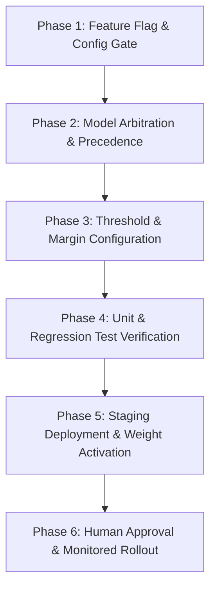

# CivicVision AI — IRDID Classifier Implementation-Readiness Review

**Document Version:** 1.0.0  
**Date:** October 13, 2026  
**Auditor:** Antigravity AI Architecture & Safety Review Team  
**Target Repository:** `E:\City_Care`  
**Candidate Checkpoint:** `runs\classify\runs\classify\irdid_cls_manual\weights\best.pt`  
**Operational Status:** **QUARANTINED — REVIEW & PLANNING ONLY (DEPLOYMENT STRICTLY UNAUTHORIZED)**

---

## 1. Executive Summary

This implementation-readiness review evaluates the candidate Indian Road Damage and Infrastructure Dataset (IRDID) six-class image classifier quarantined at `runs\classify\runs\classify\irdid_cls_manual\weights\best.pt`. 

The purpose of this document is to establish a rigorous, read-only architectural evaluation and an actionable, minimal implementation plan required before any future authorization to integrate or activate the model could be considered.

### Key Audit Baseline
The review establishes its baseline upon verified evaluation artifacts:
- **Held-Out Test Sample:** 105 images (`broken_edges`: 11, `construction_zones`: 16, `cracks`: 23, `open_manholes`: 10, `potholes`: 30, `waterlogged_roads`: 15).
- **Reported Overall Metrics:** Accuracy: **86.67%**, Macro Precision: **85.53%**, Macro Recall: **84.76%**, Macro F1-Score: **84.82%**.
- **Critical Class Performance:**
  - `broken_edges` (candidate for *Damaged Road Surface*): Recall = **63.64%** (7 TP, 4 FN, 3 FP).
  - `waterlogged_roads` (candidate for *Waterlogging*): Recall = **80.00%** (12 TP, 3 FN, 0 FP), Precision = **100.00%**.
- **Dataset Licensing Status:** **NOT VERIFIED**. Provenance records exist in the repository documentation, but commercial and municipal redistributable licensing terms for IRDID have not been legally established.

### Core Architecture Findings
1. **Accidental Activation Hazard:** In the current codebase (`backend/app/services/models/classification_adapter.py`), the adapter's availability is governed solely by `_weights_path.exists()`. If candidate weights were copied to `backend/app/services/weights/irdid_classifier.pt`, the model would **activate immediately without an explicit configuration toggle or feature flag**.
2. **Arbitration Conflict:** In `backend/app/services/ai_service.py`, primary defect selection is determined by `max(valid_detections, key=lambda x: x["confidence"])`. Without an explicit precedence rule, high-confidence whole-image classification could silently override fine-grained, localized YOLO object detections.
3. **Robust Isolation Boundaries Already Present:** The adapter class (`IRDIDClassificationAdapter`) already strictly suppresses synthetic bounding boxes (`bounding_box: None`), and the defect registry (`backend/app/core/defect_registry.py`) already separates `open_manholes` (`DEPT_SEW`) from stormwater `Damaged Drainage Covers` (`DEPT_DRAIN`).

**Overall Review Verdict:** **READY FOR IMPLEMENTATION PLANNING**  
*(Note: This verdict authorizes engineering planning and test design only; physical deployment, weight activation, and runtime integration remain strictly blocked.)*

---

## 2. Verified Current Architecture and Evidence

An inspection of the existing source code in `E:\City_Care` was conducted. Below is the documented behavior of all relevant subsystems.

### 2.1 Model Registration and Weight Discovery
- **Source File:** [`backend/app/services/models/registry.py`](file:///E:/City_Care/backend/app/services/models/registry.py)
  - Function: `ModelRegistry._initialize_adapters()` (`L17-50`)
  - The registry instantiates five adapters:
    1. `YOLOv8RoadDamageAdapter()` (`model_id="yolov8-rdd2020-india-v1"`) — Active detection model.
    2. `PendingModelAdapter("sanitation-detector-v1")` — Sanitation defects (quarantined pending dataset access).
    3. `PendingModelAdapter("drainage-detector-v1")` — Drainage defects (quarantined pending dataset access).
    4. `IRDIDClassificationAdapter()` (`model_id="irdid-classifier-candidate"`) — Candidate classification adapter.
    5. `PendingModelAdapter("utility-safety-v1")` — Utility defects (open manholes, broken streetlights; quarantined outside active 12 categories).
  - Function: `ModelRegistry.get_all_active_adapters()` (`L57-58`)
    - Filters adapters using `adapter.is_available`.
- **Source File:** [`backend/app/services/models/classification_adapter.py`](file:///E:/City_Care/backend/app/services/models/classification_adapter.py)
  - Function: `__init__()` (`L23-30`)
    - Resolves default path: `backend/app/services/weights/irdid_classifier.pt`.
  - Function: `is_available` property (`L41-46`):
    ```python
    @property
    def is_available(self) -> bool:
        if not self._weights_path or not self._weights_path.exists():
            return False
        if not self._is_loaded and not self._load_error:
            self._lazy_load()
        return self._is_loaded
    ```
  - **Evidence:** Weight discovery relies strictly on physical file presence on disk. No environment variable, feature toggle, or configuration gate exists.

### 2.2 Class-Name Mapping and Supported-Category Filtering
- **Source File:** [`backend/app/services/models/classification_adapter.py`](file:///E:/City_Care/backend/app/services/models/classification_adapter.py)
  - `CLASS_MAPPING = {"broken_edges": "Damaged Road Surface", "waterlogged_roads": "Waterlogging", ...}` (`L16-21`)
  - `supported_categories = ["Damaged Road Surface", "Waterlogging"]` (`L37-38`)
  - Function: `infer()` (`L77-85`):
    - Raw predictions from Ultralytics (`result.names[top_idx]`) are mapped via `CLASS_MAPPING`.
    - Detections are appended **only** if `mapped_name in self.supported_categories`.
  - **Evidence:** Unsupported model classes (`cracks`, `potholes`, `construction_zones`, `open_manholes`) are rejected by the adapter and return `raw_detections: []`.

### 2.3 Confidence-Score Handling
- **Source File:** [`backend/app/services/models/classification_adapter.py`](file:///E:/City_Care/backend/app/services/models/classification_adapter.py)
  - `conf = float(result.probs.top1conf.item())` (`L76`)
  - The adapter takes the raw, uncalibrated top-1 softmax output from Ultralytics and performs no internal thresholding.
- **Source File:** [`backend/app/services/ai_service.py`](file:///E:/City_Care/backend/app/services/ai_service.py)
  - Function: `analyze_issue_image()` (`L72-79`):
    - Queries `get_category_spec(category_name).get("confidence_threshold", 0.25)`.
- **Source File:** [`backend/app/core/defect_registry.py`](file:///E:/City_Care/backend/app/core/defect_registry.py)
  - `Damaged Road Surface`: `confidence_threshold: 0.30` (`L130`)
  - `Waterlogging`: `confidence_threshold: 0.30` (`L217`)
  - **Evidence:** The runtime threshold is currently set to `0.30`. The higher thresholds (0.85 and 0.80) recommended in prior audit reports are not implemented in code.

### 2.4 Classification Responses and Bounding-Box Behavior
- **Source File:** [`backend/app/services/models/classification_adapter.py`](file:///E:/City_Care/backend/app/services/models/classification_adapter.py)
  - Function: `infer()` explicitly assigns `"bounding_box": None` (`L84`).
- **Source File:** [`backend/app/services/ai_service.py`](file:///E:/City_Care/backend/app/services/ai_service.py)
  - `bounding_boxes` list only ingests detections where `coords and len(coords) == 4` (`L109-137`).
  - Detections with `bounding_box: None` are routed to `detected_defects` with `bounding_box: None` (`L140-145`).
  - OpenCV annotation (`L171-176`) iterates strictly over `bounding_boxes`, preventing synthetic box rendering on the output image.
  - `defect_area_ratio` remains `0.0` for whole-image classification.
- **Source File:** [`backend/app/api/v1/endpoints/issues.py`](file:///E:/City_Care/backend/app/api/v1/endpoints/issues.py)
  - `IssueImage.bounding_box_json` persists `"[]"` for classification-only submissions (`L115`).
  - **Evidence:** Synthetic bounding boxes are strictly avoided across all backend layers.

### 2.5 Manual-Reporting Fallback When AI Is Unavailable
- **Source File:** [`backend/app/services/ai_service.py`](file:///E:/City_Care/backend/app/services/ai_service.py)
  - If no models are active: returns `status: "vision_unavailable"`, `detected_defects: []` (`L44-51`).
  - If confidence is below threshold: returns `status: "no_detection"` (`L81-99`).
- **Source File:** [`backend/app/api/v1/endpoints/issues.py`](file:///E:/City_Care/backend/app/api/v1/endpoints/issues.py)
  - Function: `create_issue()` (`L88-113`):
    - If `ai_confidence == 0` or bounding boxes are empty and analysis status is not `SUCCESS`:
      - `initial_status = IssueStatus.REPORTED`
      - `ai_analysis_status = "MANUAL_OR_UNAVAILABLE"`
      - `latest_update = "Report submitted with citizen-selected category."`
  - **Evidence:** Manual citizen reporting operates cleanly and independently of vision model availability.

### 2.6 Error Handling and Model-Loading Failures
- **Source File:** [`backend/app/services/models/classification_adapter.py`](file:///E:/City_Care/backend/app/services/models/classification_adapter.py)
  - Weight absence: `is_available` returns `False`; `infer()` returns `status: "unsupported"`, `error_message: "Classification weights not found at..."`, `raw_detections: []` (`L60-67`).
  - Loading failure: caught via `try...except Exception as e`, setting `self._load_error` and keeping `is_available = False` (`L56-57`).
  - Inference failure: caught via `try...except Exception as e`, returning `status: "error"`, `raw_detections: []`, and error message without process termination (`L95-103`).
- **Evidence:** Errors fail safely and do not crash the FastAPI application process.

### 2.7 API Consumer Discrimination (Detection vs. Classification)
- In `POST /api/v1/issues/analyze-image` response:
  - Detection results yield: non-empty `bounding_boxes`, `defect_area_ratio > 0`, `is_real_yolo: True`.
  - Classification results yield: `bounding_boxes: []`, `detected_defects[0].bounding_box: null`, `defect_area_ratio: 0.0`, `is_real_yolo: False`.
  - `model_provenance` dictionary identifies the executing `model_id`.
- **Evidence:** API consumers can unambiguously differentiate spatial object detection from whole-image classification.

---

## 3. Existing Behavior versus Proposed Changes

The table below contrasts the current implementation against the minimal changes required for safe activation.

| Subsystem / Capability | Current Implementation (Inspected Code) | Proposed Future Implementation | Rationale & Safety Justification |
|---|---|---|---|
| **Activation Gate** | **File presence only:** Activates automatically if file exists at `backend/app/services/weights/irdid_classifier.pt`. | **Explicit Feature Flag:** Require `settings.ENABLE_IRDID_CLASSIFIER=True` in `backend/app/core/config.py` and `.env`. Default: `False`. | Prevents accidental activation if weights are placed in the directory during staging or evaluation. |
| **Model Precedence / Arbitration** | **Max Confidence:** `ai_service.py:L151` selects `max(valid_detections, key=lambda x: x["confidence"])`. | **Spatial Precedence:** Localized YOLO detections (`Pothole`, `Crack`) always take priority over coarse whole-image classification. | Prevents scene-level classifier from overriding localized crack or pothole coordinates. |
| **Confidence Thresholding** | Hardcoded generic `0.30` in `defect_registry.py`. Raw softmax score passed directly. | Configurable per-category thresholds: `Damaged Road Surface: 0.85`, `Waterlogging: 0.80`. Label as uncalibrated. | Mitigates high false-positive rates on ambiguous or cluttered road scenes. |
| **Out-of-Distribution Handling** | None. Any image is evaluated and assigned top-1 class. | Minimum score margin rule: Require top-1 confidence $\ge \tau$ AND top-1 minus top-2 margin $\ge 0.20$; else abstain. | Rejects ambiguous, multi-label, or non-infrastructure images safely. |
| **Broken Edges Low-Recall Safeguard** | None. Model treated as authoritative classifier. | Triage flag: Tag all `Damaged Road Surface` issues with `requires_human_verification: True`. | Mitigates the verified 36.36% false-negative rate on broken edges. |
| **Telemetry & Audit Logging** | Transient `model_provenance` returned in API response; not persisted to disk. | Append inference metadata (`model_id`, raw score, mapped category, timestamp) to application log file. | Enables operational drift detection and auditing without violating citizen PII. |
| **Rollback Mechanism** | Manual physical deletion of `.pt` file from disk. | Toggle `ENABLE_IRDID_CLASSIFIER=False` in environment; zero file mutation required. | Provides a $<30\text{s}$ safe rollback mechanism without service interruption. |

---

## 4. Category Mapping and Model-Selection Rules

### 4.1 Permitted Category Mappings
The proposed classifier integration is restricted strictly to two mappings:
1. `broken_edges` $\longrightarrow$ **`Damaged Road Surface`** (Domain: `ROAD`, Dept: `DEPT_PWD`, SLA: 7 days)
2. `waterlogged_roads` $\longrightarrow$ **`Waterlogging`** (Domain: `DRAINAGE`, Dept: `DEPT_DRAIN`, SLA: 24 hours)

### 4.2 Prohibited Mappings and Suppression Rules
The four remaining classifier outputs must be handled as follows:

| Candidate Model Class | Action | Reason & Operational Boundary |
|---|:---:|---|
| `cracks` | **SUPPRESS / IGNORE** | Conflicts with active YOLOv8 detector (`D00`, `D10`, `D20`). YOLO provides spatial bounding boxes; classification provides coarse labels with no localization. |
| `potholes` | **SUPPRESS / IGNORE** | Redundant with active YOLOv8 detector (`D40`). YOLO localization is necessary for road maintenance dispatch. |
| `construction_zones` | **SUPPRESS / IGNORE** | Active construction is authorized civil work, not an actionable infrastructure defect. Creating automated repair tickets generates circular workflows. |
| `open_manholes` | **STRICTLY EXCLUDE** | Sewer utility shafts (`DEPT_SEW`) are physically and administratively distinct from curbside stormwater grates (`Damaged Drainage Covers`, `DEPT_DRAIN`). |

### 4.3 Multi-Model Arbitration Rules in `ai_service.py`
To prevent the classifier from masking YOLO detections, the primary category selection in `ai_service.py` must follow this precedence hierarchy:

```
Step 1: Check for Valid YOLO Detections (bounding_box is not None)
        └── If YES: Primary defect MUST be selected from YOLO detections (highest risk / highest confidence).
                    Classifier output is stored strictly as secondary scene context in detected_defects.
Step 2: If NO Valid YOLO Detections Exist:
        └── Check for Valid Classification Detections (Damaged Road Surface or Waterlogging).
            └── If confidence >= category threshold AND margin >= 0.20:
                └── Primary defect = Mapped Classification Category (bounding_boxes = []).
Step 3: If Neither Model Exceeds Threshold:
        └── Return status = "no_detection" (clean fallback to manual reporting).
```

---

## 5. Safeguards and Their Implementation Status

The table below audits the 10 mandatory deployment safeguards against the active codebase:

| Safeguard Specification | Current Code Status | Inspected File & Evidence | Implementation Gap / Action Required |
|---|:---:|---|---|
| **1. Explicit Feature Flag (Disabled by Default)** | **NOT IMPLEMENTED** | `classification_adapter.py:L41-46` activates solely on `_weights_path.exists()`. | Add `settings.ENABLE_IRDID_CLASSIFIER: bool = False` to `app/core/config.py` and gate `is_available`. |
| **2. Configurable Confidence Thresholds** | **PARTIALLY IMPLEMENTED** | `defect_registry.py:L130,217` sets static `0.30`. Uncalibrated softmax scores used. | Update registry thresholds to `0.85` (broken edges) and `0.80` (waterlogging); document scores as uncalibrated. |
| **3. Safe Handling of Unsupported Classes** | **IMPLEMENTED** | `classification_adapter.py:L79-85` filters classes outside `supported_categories`. | None; existing allowlist filtering works as intended. |
| **4. Out-of-Distribution (OOD) Image Rejection** | **NOT IMPLEMENTED** | No entropy, margin, or non-infrastructure filter in `ai_service.py` or adapter. | Add top-1 vs top-2 probability margin check ($\ge 0.20$) before accepting classification. |
| **5. Distinction: Classification vs. Detection** | **IMPLEMENTED** | `classification_adapter.py:L84` (`bounding_box: None`) and `ai_service.py:L138-146`. | None; API response and schema enforce `bounding_box: None` and `bounding_boxes: []`. |
| **6. Fallback to Manual Reporting** | **IMPLEMENTED** | `ai_service.py:L43-51` and `issues.py:L88-113` support `MANUAL_OR_UNAVAILABLE`. | None; manual submission is fully operational and tested. |
| **7. Error Handling & Privacy-Conscious Logging** | **PARTIALLY IMPLEMENTED** | Exception handling is structured (`classification_adapter.py:L95-103`), but privacy logging is absent. | Add structured logging of inference metadata without storing raw image bytes or citizen PII. |
| **8. Accidental Activation Protection** | **NOT IMPLEMENTED** | Physical file placement triggers instant runtime activation. | Dependent on Safeguard 1 (feature flag requirement). |
| **9. Reliable Disable / Rollback Procedure** | **PARTIALLY IMPLEMENTED** | Rollback currently requires physical file deletion from disk. | Dependent on Safeguard 1 (setting `ENABLE_IRDID_CLASSIFIER=False` in `.env`). |
| **10. YOLO & Manual-Reporting Regression Coverage** | **IMPLEMENTED** | `test_multi_category_pipeline.py` (585 lines) and `test_classification_adapter_smoke.py` (239 lines). | Expand test suite to include dual-model coexistence and feature-flag toggle tests. |

---

## 6. Proposed Testing Matrix

The following test plan outlines the suites required to validate classifier integration after authorization.

### 6.1 Unit Tests (Model Adapter Level — Mock Weights)
*Target File:* `backend/app/test_classification_adapter_smoke.py` (Existing, to be expanded)
- **UT-01 (Feature Flag Disabled):** Instantiate adapter with valid mock weights but `settings.ENABLE_IRDID_CLASSIFIER = False`. Assert `is_available == False` and `infer()` returns `status="unsupported"`.
- **UT-02 (Feature Flag Enabled):** Set flag to `True`. Assert `is_available == True` and model lazily loads.
- **UT-03 (Supported Class Mapping):** Mock model output for `broken_edges` and `waterlogged_roads`. Assert mapped category is correct and `bounding_box is None`.
- **UT-04 (Unsupported Class Filtering):** Mock model output for `cracks`, `potholes`, `construction_zones`, `open_manholes`. Assert `raw_detections == []`.
- **UT-05 (Margin Threshold Abstention):** Mock probabilities `[0.45, 0.40, ...]`. Assert adapter returns `raw_detections == []` due to margin $< 0.20$.
- **UT-06 (Exception Resilience):** Mock `RuntimeError` during inference. Assert `status == "error"` and no unhandled exception.

### 6.2 Integration Tests (Pipeline & Arbitration Level — Ephemeral DB)
*Target File:* `backend/app/test_multi_category_pipeline.py` (Existing, to be expanded)
- **IT-01 (Dual Model Arbitration — YOLO Priority):** Provide image triggering both YOLO (`Pothole`, conf `0.70`) and Classifier (`Damaged Road Surface`, conf `0.85`). Assert primary defect is `Pothole` and bounding boxes are preserved.
- **IT-02 (Classification-Only Issue Persistence):** Provide image with zero YOLO detections and valid `Waterlogging` classification. Assert issue is persisted with `issue_type="Waterlogging"`, `bounding_box_json="[]"`, and routed to `DEPT_DRAIN`.
- **IT-03 (Missing Weights Graceful Fallback):** Delete mock weights. Assert `/analyze-image` returns `status="vision_unavailable"` or `status="no_detection"` and issue submission succeeds as manual report.
- **IT-04 (Zero Database Pollution):** Run all integration tests using `sqlite:///:memory:` or ephemeral temporary database. Assert `civicsense.db` is never touched.

### 6.3 API & Contract Tests (FastAPI Endpoint Level)
*Target File:* `backend/app/test_api_contracts.py` (New test file)
- **AT-01 (Schema Stability):** Assert `POST /api/v1/issues/analyze-image` response schema is identical with classifier enabled or disabled.
- **AT-02 (Map Data Compatibility):** Query `GET /api/v1/issues/map-data`. Assert issues created via classification render with latitude/longitude and empty bounding boxes without frontend map parse errors.

### 6.4 Manual Acceptance Tests (Staging Environment Only — Real Weights)
*Target Environment:* Isolated Staging Server (NOT Production)
- **MAT-01 (End-to-End Broken Edge Report):** Citizen uploads damaged road edge photo. Verify issue appears in Road Dept queue with `Damaged Road Surface` and `requires_human_verification=True`.
- **MAT-02 (End-to-End Waterlogging Report):** Citizen uploads flooded road photo. Verify issue routes to Stormwater Drainage Dept with `Waterlogging`.
- **MAT-03 (Live Rollback Execution):** Set `ENABLE_IRDID_CLASSIFIER=False` in staging environment. Verify within 30 seconds that classification stops executing without application downtime.

---

## 7. Risks, Dependencies, and Unresolved Questions

### 7.1 Identified Risks
1. **Low Recall on Broken Edges (Risk Level: HIGH):**  
   The candidate model demonstrated a **63.64% recall** on `broken_edges` in held-out testing (missed 4 of 11 ground truth cases). Relying on this classifier as an automated detection mechanism risks missing more than 36% of road edge damage.
2. **Missing Severity / Depth Awareness (Risk Level: MEDIUM):**  
   `waterlogged_roads` classification identifies water presence across the whole image, but cannot assess water depth, flooded surface area, or road passability. A puddle may receive the same classification as impassable flooding.
3. **Domain Shift in Real Municipal Conditions (Risk Level: HIGH):**  
   The IRDID training dataset predominantly features daylight, dry-weather scenes. Nighttime reporting, heavy rain, smartphone sensor noise, and varied camera angles may produce unpredictable classification errors.
4. **Accidental Silent Overwrite (Risk Level: HIGH):**  
   In the absence of a feature flag, any deployment script that places weights into `backend/app/services/weights/irdid_classifier.pt` will activate the model immediately.

### 7.2 Dependencies
- **Ultralytics Dependency:** The runtime environment must have `ultralytics` installed and accessible to the backend Python process.
- **Hardware Acceleration:** Inference requires GPU availability (`device: '0'`) or acceptable CPU fallback latency ($< 300\text{ ms}$).

### 7.3 Unresolved Questions
1. **Legal Licensing:** What is the specific commercial and municipal redistribution license for the IRDID dataset? Does it permit deployment in civic administration systems?
2. **Operational Triage Policy:** Does the Road & Public Works Department have the triage capacity to manually verify `Damaged Road Surface` reports given the 36% false-negative rate?
3. **Threshold Calibration:** Can empirical temperature scaling be performed on a larger validation split before setting production confidence thresholds?

---

## 8. Minimal Future Implementation Plan (Ordered by Priority)

If and when formal authorization is granted, implementation must proceed in the following strict sequential phases:



### Phase 1: Environment & Configuration Safeguards (Priority: HIGHEST)
1. Add `ENABLE_IRDID_CLASSIFIER: bool = False` to `backend/app/core/config.py` and `.env.example`.
2. Update `IRDIDClassificationAdapter.is_available` in `classification_adapter.py` to require `settings.ENABLE_IRDID_CLASSIFIER is True` in addition to file existence.
3. Add log notice on startup declaring whether the classifier is enabled or disabled.

### Phase 2: Dual-Model Arbitration & Precedence (Priority: HIGH)
1. Update `backend/app/services/ai_service.py:L150-154`:
   - Implement the spatial precedence rule: if any valid localized detection (`bounding_box is not None`) exists, select primary category from localized detections.
   - Restrict classification selection to scenarios where zero localized YOLO detections exist.
2. Ensure classification outputs always append to `detected_defects` with `bounding_box: None`.

### Phase 3: Calibrated Thresholds & Margin Filtering (Priority: MEDIUM)
1. Update `backend/app/core/defect_registry.py`:
   - Set `confidence_threshold: 0.85` for `Damaged Road Surface`.
   - Set `confidence_threshold: 0.80` for `Waterlogging`.
2. Update `classification_adapter.py`:
   - Implement minimum margin rule ($\text{top1} - \text{top2} \ge 0.20$) to reject ambiguous or multi-defect scenes.

### Phase 4: Automated Test Execution (Priority: HIGH)
1. Execute expanded unit test suite in `backend/app/test_classification_adapter_smoke.py`.
2. Execute multi-category pipeline test suite in `backend/app/test_multi_category_pipeline.py`.
3. Verify that zero tests touch `civicsense.db` or alter Git state.

### Phase 5: Staging Deployment & Controlled Activation (Priority: MEDIUM)
1. Copy weights from quarantined path `runs/classify/.../best.pt` to `backend/app/services/weights/irdid_classifier.pt` in **staging environment only**.
2. Verify SHA-256 matches `84637d53361e46522b87125fe4433fd619196a062d99db705fabcff379cccf45`.
3. Set `ENABLE_IRDID_CLASSIFIER=True` in staging `.env`.
4. Run staging smoke tests.

### Phase 6: Human Approval Gate & Production Rollout (Priority: FINAL)
1. Present staging test report to municipal stakeholders and project lead.
2. Obtain explicit written authorization.
3. Deploy to production with monitoring and rollback toggles active.

---

## 9. Deployment Approval Checklist

Every item in this checklist must be satisfied before production activation:

- [ ] **Gate 1: Dataset Licensing Verified**  
  Legal verification confirming the IRDID dataset permits municipal automated processing.
- [ ] **Gate 2: Checkpoint Provenance & Cryptographic Integrity Confirmed**  
  `best.pt` SHA-256 confirmed as `84637d53361e46522b87125fe4433fd619196a062d99db705fabcff379cccf45`.
- [ ] **Gate 3: Evaluation Artifacts & Marginals Reconciled**  
  Held-out test split of 105 images verified with authentic confusion matrix column marginals `[11, 16, 23, 10, 30, 15]`.
- [ ] **Gate 4: Performance Criteria & Low-Recall Acceptance Approved**  
  Municipal stakeholder approval of 63.64% recall on broken edges with mandatory human verification triage.
- [ ] **Gate 5: Runtime Safeguards Implemented & Tested**  
  Feature flag (`ENABLE_IRDID_CLASSIFIER`), spatial precedence rule, and margin filtering implemented in code.
- [ ] **Gate 6: Regression Protection Verified**  
  YOLO detector hash (`289e3e17...`) untouched; manual reporting verified via automated test suite.
- [ ] **Gate 7: Zero Synthetic Bounding Boxes Confirmed**  
  Test verification proving `bounding_box: None` and `bounding_boxes: []` across all classification routes.
- [ ] **Gate 8: Rollback & Monitoring Protocol Documented**  
  $<30\text{s}$ rollback procedure via environment toggle tested and verified in staging.
- [ ] **Gate 9: Explicit Human Authorization Obtained**  
  Formal written approval signed off prior to activating weights in production.

---

## 10. Final Verdict

### **STATUS: READY FOR IMPLEMENTATION PLANNING**

> **MANDATORY SAFETY NOTICE:**  
> This verdict indicates that the technical prerequisites, architectural boundaries, and testing protocols have been evaluated and planned.  
> **IT DOES NOT CONSTITUTE PERMISSION TO DEPLOY, ACTIVATE, COPY, OR INTEGRATE THE CLASSIFIER WEIGHTS.**  
> The candidate model weights remain strictly **quarantined** at `runs\classify\runs\classify\irdid_cls_manual\weights\best.pt`. Production runtime directories remain empty. No further action may be taken without explicit written authorization.
